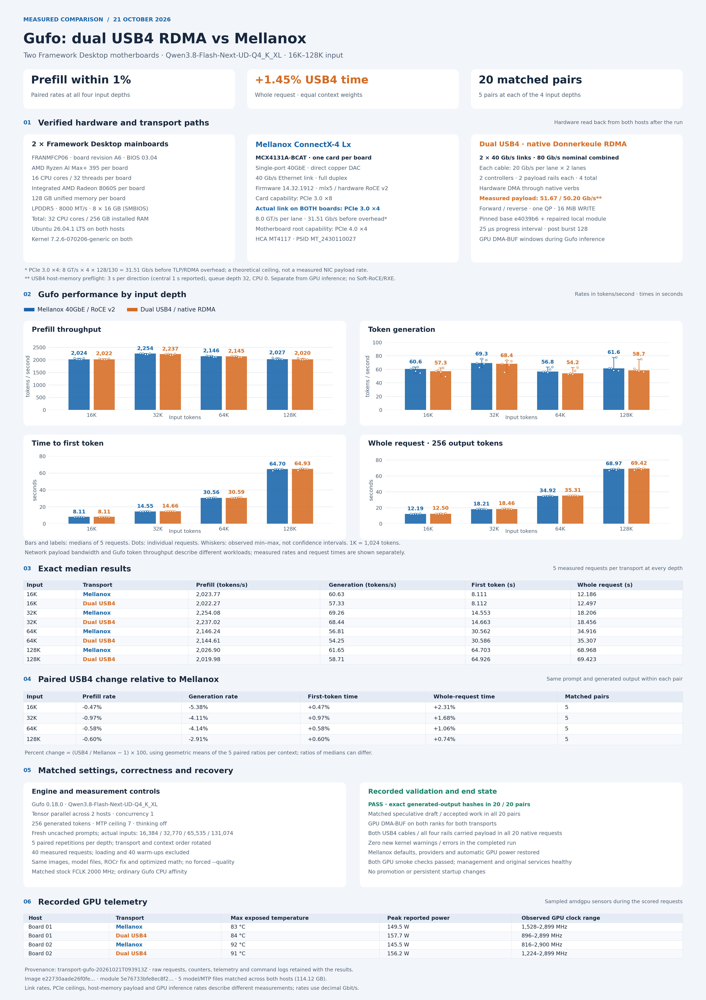

# Gufo and network measurements on two Framework Desktop boards

**Date:** 21 October 2026. Two Framework Desktop FRANMFCP06/A6 motherboards,
Ryzen AI Max+ 395 / Radeon 8060S, 128 GB memory at 8000 MT/s per board, BIOS 03.04.
Ubuntu 26.04.1 LTS; Linux `7.2.6-070206-generic`.

[Full PNG chart (4000 × 5660)](gufo-transport-full.png) · [Setup and changes](../../../docs/framework-desktop.md)

## Network setup

| Transport | Hardware and active configuration |
|---|---|
| Native USB4 | 2 cables, each 40 Gb/s negotiated; 2 controllers × 2 payload rails; one QP pools all four |
| Mellanox | ConnectX-4 Lx MCX4131A-BCAT per host; single-port 40GbE DAC; firmware 14.32.1912; hardware RoCE v2 |
| NIC PCIe link | PCIe 3.0 ×4 at 8 GT/s per lane on both hosts; card capability Gen3 ×8; motherboard root capability Gen4 ×4 |

Two three-second, single-QP, 16 MiB host-memory WRITE preflights measured
**51.67 Gb/s forward** and **50.20 Gb/s reverse**. Queue depth 32, CQ moderation 1,
CPU 0, post burst 128; perftest reports the central one-second interval.
Counters proved all four rails carried payload. The negotiated 80 Gb/s sum,
measured host-memory payload, and GPU inference throughput are separate metrics.
No matched Mellanox bulk-bandwidth preflight was collected in this Gufo run.
The NIC Gen3 ×4 line-code ceiling is 31.51 Gb/s before protocol overhead.

## Gufo application measurements

Gufo 0.18.0; Qwen3.8-Flash-Next-UD-Q4_K_XL; tensor parallel across two hosts;
concurrency 1; MTP ceiling 7; thinking off; 256 actual generated tokens.
Each input depth has five fresh, uncached prompt pairs. Loading and 40 warm-ups
are excluded from 40 scored requests. The transport order alternates and input
depth order rotates. Engine/image, model hashes, ROCr fix, optimized math and
stock FCLK 2000 MHz policy match between arms. No forced `--quality` flag.
Both transports use GPU DMA-BUF windows on both ranks.

| Input | Transport | Prefill tokens/s | Generation tokens/s | First token s | Whole request s |
|---|---|---:|---:|---:|---:|
| 16K | Mellanox | 2023.77 | 60.63 | 8.111 | 12.186 |
| 16K | Dual USB4 | 2022.27 | 57.33 | 8.112 | 12.497 |
| 32K | Mellanox | 2254.08 | 69.26 | 14.553 | 18.206 |
| 32K | Dual USB4 | 2237.02 | 68.44 | 14.663 | 18.456 |
| 64K | Mellanox | 2146.24 | 56.81 | 30.562 | 34.916 |
| 64K | Dual USB4 | 2144.61 | 54.25 | 30.586 | 35.307 |
| 128K | Mellanox | 2026.90 | 61.65 | 64.703 | 68.968 |
| 128K | Dual USB4 | 2019.98 | 58.71 | 64.926 | 69.423 |

Table values are medians. Actual input counts are 16,384 / 32,770 / 65,535 /
131,074 tokens. Every scored request generated 256 tokens.

| Input | USB4 prefill rate change | USB4 generation rate change | USB4 first-token time change | USB4 whole-request time change |
|---|---:|---:|---:|---:|
| 16K | -0.47% | -5.38% | +0.47% | +2.31% |
| 32K | -0.97% | -4.11% | +0.97% | +1.68% |
| 64K | -0.58% | -4.14% | +0.58% | +1.06% |
| 128K | -0.60% | -2.91% | +0.60% | +0.74% |

These changes use geometric means of the five paired USB4/Mellanox ratios,
not ratios of medians. Equal weighting of the four contexts gives **+1.45%**
USB4 whole-request time. Prefill rates differ by less than 1% at each depth.
Absolute generation rates vary with the prompt and speculative work.

All 20 generated-output hashes match across transports. Speculative draft,
accepted-token and related work matched within every pair. Both USB4 cables
and all four rails carried payload during every native request. No new kernel
warnings/errors were observed in the completed comparison. The original
networking/provider configuration, automatic GPU power, management and service
health were restored afterward. This records the completed run; publishing the
fork did not restart inference or a full benchmark.

## Published evidence and reproduction

- `measurements.json` / `measurements.csv`: all 40 scored observations with
  anonymized host identity, token counts, rates/times and prompt/output hashes.
- `summary.json` / `summary.csv`: medians by context and transport.
- `benchmark-validation.json`: paired ratios, output/work agreement and qualification.
- `transport-proof.json`: per-request counter deltas with anonymous board labels.
- `network-preflight.json`: the separate host-memory payload observations.
- `chart-hardware.json`, `method.json`, `telemetry-summary.json`: redacted hardware,
  settings and recorded amdgpu sensor summaries.
- `images.json`, `models-sha256.json`: image/binary/model provenance. Images and
  weights are not included. Private request text, credentials, addresses, SSH
  configuration and raw machine logs remain outside this repository.

Render the PNG locally with Python, Matplotlib and NumPy (Pillow verifies its dimensions):

```sh
python3 -m venv /tmp/donnerkeule-chart-env
/tmp/donnerkeule-chart-env/bin/pip install matplotlib==3.9.4 numpy pillow
/tmp/donnerkeule-chart-env/bin/python bench/results/2026-10-21-framework-desktop/tools/render-full-chart.py
```

The application results describe this model, engine, hardware and context range.
The remaining bulk DMA/completion limit is unresolved; 60–80 Gb/s payload and
performance on other kernels, IOMMU policies or GPUs are not established.


